# Руководство пользователя / User manual

[English version below](#english)

Версия 1.0.0, октябрь 2026. Руководство описывает то, что есть в программе сейчас, а не планы. Сайт проекта: <https://iresultman.github.io/pulinto/>.

## Что это

PuLinTo исправляет слово, набранное не в той раскладке. Напечатали `ghbdtn`, не заметив, что
клавиатура в английской, и на экране окажется «привет». Работает и в обратную сторону: `рщц`
станет `how`. Слово исправляется на пробеле или знаке, раньше, чем они дойдут до окна, поэтому
сообщение уходит в чат уже правильным. Раскладка при этом тоже переключается, и следующее слово
вы набираете в нужной.

Что важно знать с первой минуты:

- **При сомнении программа ничего не трогает.** Пропущенное слово исправляется одним нажатием
  клавиши, а испорченное сообщение не вернуть.
- **Пароли, адреса, команды, код и слова вперемешку из двух алфавитов не меняются.**
- **Журнала набора нет.** Что записывается на диск, перечислено в разделе «Приватность».
- **Программа запоминает ваши правила:** автозамены, слова, которые трогать нельзя, режим для
  каждой программы.

Работает в X11 (проверялось на XFCE) и в GNOME на Wayland (GNOME 50, Ubuntu 26.04), набор на
русском и английском. Точность на отложенном корпусе из 21 300 слов: 99,38 %, испорченных слов
0,06 % ([как это измерено](MEASUREMENTS.md)).

---

## Установка

### Одной командой

```
curl -fsSL https://iresultman.github.io/pulinto/install.sh | bash
```

Команда скачивает готовую сборку последнего выпуска, проверяет контрольную сумму и устанавливает
программу для вашего пользователя, без root. Один раз она спросит пароль администратора: нужно
правило, которое разрешает программе читать клавиатуру. Текст скрипта можно прочитать по той же
ссылке до запуска.

### Установочным файлом

| Система | Файл | Из терминала |
|---|---|---|
| Ubuntu, Debian, Linux Mint | `pulinto-x86_64.deb` | `sudo apt install ./pulinto-x86_64.deb` |
| Fedora, RHEL, AlmaLinux, Rocky | `pulinto-x86_64.rpm` | `sudo dnf install ./pulinto-x86_64.rpm` |
| Любой Linux | `pulinto-x86_64.tar.gz` | распаковать, запустить `./install.sh` |

Файлы лежат на странице [последнего выпуска](https://github.com/iResultMan/pulinto/releases/latest).
Пакет `.deb` или `.rpm` можно открыть двойным щелчком в менеджере приложений.

### Что будет после установки

Больше ничего делать не нужно. Исправления работают сразу, перезагрузка и новый вход в сеанс не
требуются. В меню приложений появится ярлык «PuLinTo» (это окно настроек), а в трее значок:
с оранжевым пробелом значит «работает», серый — «выключен».

Только в GNOME на Wayland расширение GNOME Shell (оно сообщает программе, в каком приложении
вы печатаете) подхватывается при следующем входе в сеанс. Без него не работают лишь правила для
отдельных программ в окнах Wayland. В «чистом» GNOME (например, в Fedora и RHEL) значки в трее
показывает расширение «AppIndicator and KStatusNotifierItem Support»; установка ставит и
включает его сама.

В настройках системы должно быть включено сочетание переключения раскладки, например Alt+Shift:
именно им программа переключает раскладку.

**Проверьте, что всё работает.** Откройте любое поле ввода, переключите раскладку на английскую
и наберите `ghbdtn` и пробел. Должно получиться «привет», и раскладка станет русской.

**Обновить:** выполните ту же команду установки ещё раз или поставьте новый `.deb` или `.rpm`.
Ваши правила и настройки сохраняются.

**Удалить:** `./uninstall.sh` (из архива или исходников), `sudo apt remove pulinto` или
`sudo dnf remove pulinto`. Правила и настройки в вашем домашнем каталоге остаются.

---

## Как это выглядит в работе

**Обычный набор.** Вы печатаете. Когда слово закончено пробелом или знаком, программа решает,
оставить его или исправить. Решение учитывает два предыдущих слова, а для коротких слов и следующее: после русского текста
латинские `T&` и `cnh&` становятся «Е.» и «стр.», а короткие слова из одной-двух букв читаются
по соседям. Клавиша, которая в одной раскладке знак, а в другой буква (`.` — ю, `,` — б),
решается по целому слову: `ytqhjrjvgm.nths` станет «нейрокомпьютеры», а `hello,world` разрежется
на два слова по запятой.

**Клавиша исправления.** Если программа пропустила слово, нажмите одну клавишу: одиночный `Alt` или
`Pause/Break` на клавиатуре Apple, `Pause/Break` или одиночный правый `Ctrl` на остальных. Что она сделает,
зависит от ситуации:

- есть свежее выделение: заменит выделенный текст его прочтением в другой раскладке;
- есть слово в наборе: сменит его раскладку, не дожидаясь пробела;
- слово только что закончено: переведёт его в другое прочтение, а повторное нажатие даст
  следующее. Так же откатывается неверная автозамена: вернувшись к исходному слову, вы
  говорите программе «не трогай», и она запомнит это.

Право на исправление пропадает при любом новом нажатии клавиши, щелчке мыши или нажатии стрелок: курсор ушёл, и
стирать по старому адресу уже нельзя.

**Программа ошиблась.** Нажмите клавишу исправления, чтобы откатить замену. Если хотите, чтобы
мы разобрались, нажмите `Ctrl+Alt+\` сразу после ошибки: демон запишет отчёт о последних восьми
решениях в `~/.local/share/pulinto/reports.jsonl`. Отчёт содержит слова, поэтому пишется только
по вашему нажатию и никуда сам не отправляется.

**Клавиатура не отвечает.** Нажмите одновременно `Backspace`, `Esc` и `Enter`: захват
клавиатуры снимется сразу. Потом выберите «Перезапустить» в меню значка в трее.

---

## Значок в трее

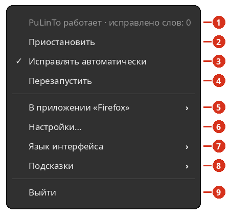

Так выглядит меню значка (схема: настоящее меню рисует ваш рабочий стол, поэтому оно может
отличаться оформлением). Строки идут в таком порядке:

1. **Состояние.** «PuLinTo работает · исправлено слов: …», «PuLinTo выключен» или «PuLinTo: только
   по горячей клавише».
2. **Приостановить / Включить.** Выключает исправления; клавиатура работает как обычно. Тот же
   пункт потом называется «Включить».
3. **Исправлять автоматически.** Снимите галочку, и слова будут исправляться только по клавише
   исправления.
4. **Перезапустить.** Помощник запускается заново, настройки не затрагиваются. Первое, что стоит
   попробовать, если что-то пошло не так.
5. **В приложении «…».** Режим для окна, в котором вы сейчас печатаете: «Исправлять автоматически»,
   «Только по горячей клавише», «Не трогать» или «Как по умолчанию» (сбрасывает ваш выбор).
6. **Настройки…** Открывает окно настроек.
7. **Язык интерфейса.** «Язык системы», «Русский», «English». Выбор запоминается и
   действует и в трее, и в окне настроек.
8. **Подсказки.** Горячие клавиши, аварийное сочетание и версия.
9. **Выйти.** Помощник полностью останавливается и выгружается из памяти до следующего входа в
   систему.

Если значка в трее нет, программа всё равно работает: настройки открываются из меню приложений.
Остановить или перезапустить помощника без значка можно выходом из сеанса и новым входом.

---

## Окно настроек

Откройте ярлык «PuLinTo» в меню приложений или пункт «Настройки…» в меню значка. Слева боковая
панель со страницами, справа сама страница. Числа у страниц на боковой панели показывают,
сколько правил на странице. Узкое окно (меньше 640 пикселей) сворачивается в один столбец с
кнопкой «назад».

В меню окна (кнопка с тремя полосками) есть: «Обновить списки», «Перепроверить клавиатуры»,
«Импорт правил…», «Экспорт правил…», «Язык интерфейса» и «Справка и горячие клавиши».

Клавиши окна: `Ctrl+F` поиск по списку, `Ctrl+N` добавить, `Delete` удалить строку в фокусе,
`Ctrl+R` или `F5` обновить, `F1` справка.

### Обзор

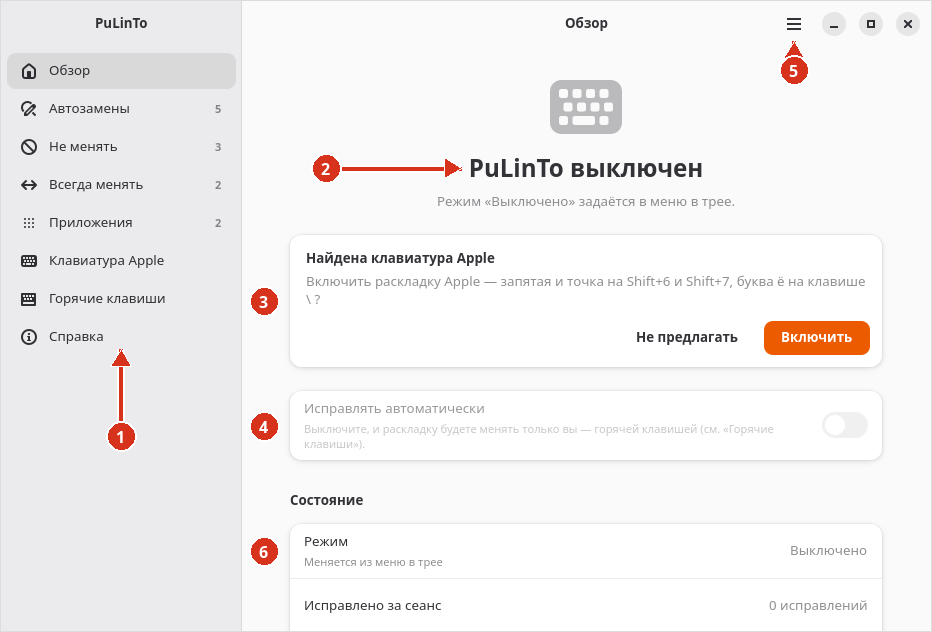

1. **Боковая панель.** Страницы окна.
2. **Состояние.** Крупная подпись: «Раскладка исправляется сама», «Только по горячей клавише» или
   «PuLinTo выключен» (как на снимке).
3. **Предложение для клавиатуры Apple.** Появляется один раз, если найдена клавиатура Apple и её
   раскладка не включена. Можно принять или отказаться.
4. **Исправлять автоматически.** То же, что флажок в меню значка. Когда PuLinTo выключен целиком,
   переключатель недоступен.
5. **Меню окна.**
6. **Состояние службы:** режим работы, сколько слов исправлено за сеанс и работает ли помощник.
   Если окно пишет «Нет связи с PuLinTo», выберите «Перезапустить» в меню значка.

### Автозамены

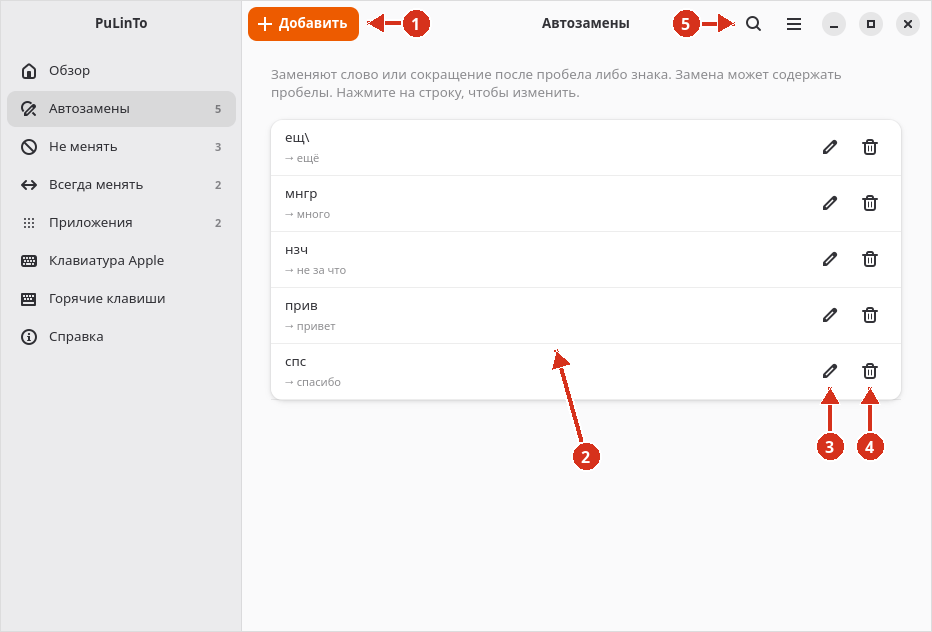

Автозамена заменяет слово или сокращение, когда вы закончили его пробелом или знаком. Результат
может содержать пробелы: «нзч» превращается в «не за что». Работают и источники со знаком:
`ещ\` → `ещё` поглощает ошибочный `\`.

1. **Добавить** (или `Ctrl+N`).
2. **Строка правила.** Щелчок по строке открывает правку.
3. **Изменить.**
4. **Удалить.** Автозамена удаляется сразу, а во всплывающей подписи есть «Отменить».
5. **Поиск** по списку (или `Ctrl+F`).

Автозамены, которые программа выучила сама после ваших повторных исправлений, отмечены меткой
«выучено»; происхождение каждого правила видно во всплывающей подсказке строки.

**Новая автозамена.**

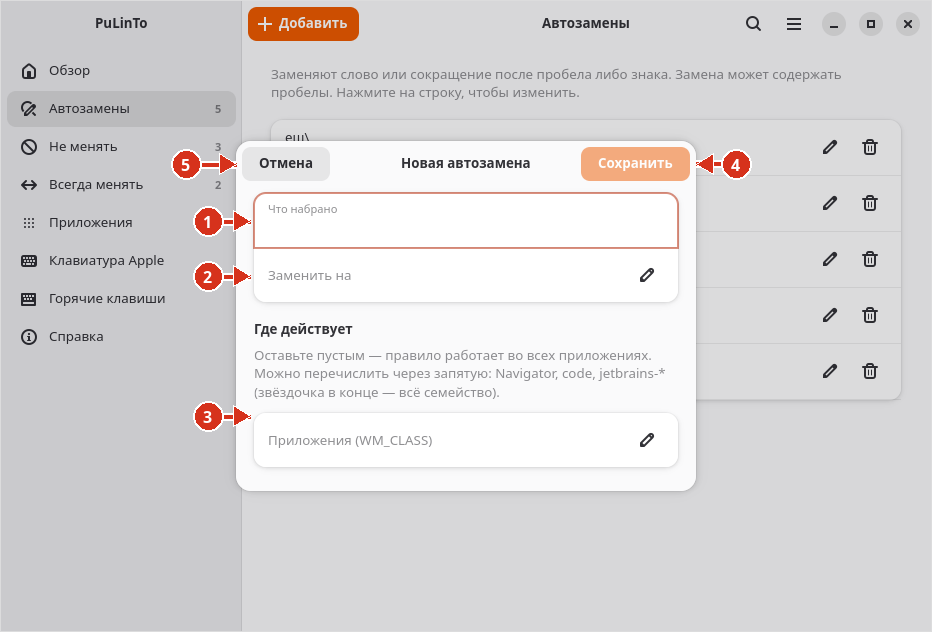

1. **Что набрано.** Слово или сокращение. Кнопка «Сохранить» не нажимается, пока обязательные
   поля пусты; отказ демона показывается в самом диалоге, введённое не теряется.
2. **Заменить на.** Чем заменить; может быть несколько слов.
3. **Где действует.** Необязательно. Пусто значит «везде». Можно перечислить классы окон через
   запятую, звёздочка в конце означает семейство: `Navigator, code, jetbrains-*`. Класс окна
   программы показан в меню значка («В приложении „…“»).
4. **Сохранить** (`Enter`).
5. **Отмена** (`Esc`).

### Не менять и Всегда менять

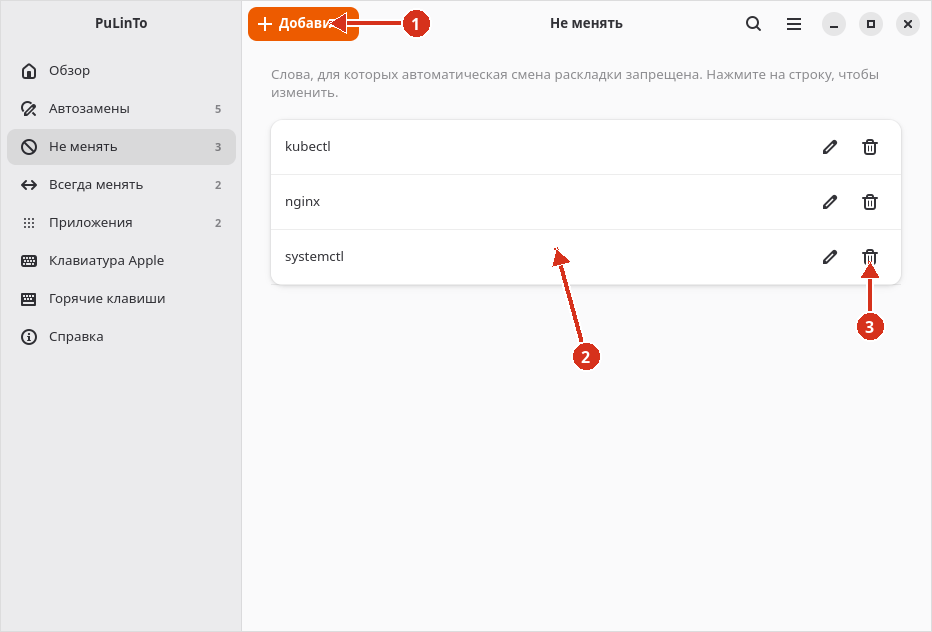

1. **Добавить.**
2. **Слова списка.** Щелчок по строке открывает правку.
3. **Удалить.** Спрашивает, «Удалить» или «Удалить и забыть»: второй вариант запрещает программе
   выучить это слово заново. Само забытое слово не сохраняется, на диск пишется только
   необратимый отпечаток (keyed SHA-256 с отдельным ключом вашей установки). Строка «Забытые
   слова» со счётчиком и кнопкой «Сбросить…» закреплена внизу страниц, пока счётчик не нулевой.
   Явное добавление того же слова вручную снова разрешает его.

**Не менять.** Слова, которые нельзя исправлять автоматически: названия команд, ники, термины.
Слово должно быть не короче трёх символов: частые короткие слова из списка ломали бы выбор языка.

**Всегда менять.** Слова, которые нужно исправлять всегда, даже когда программа не уверена.
Записывать нужно слово так, как оно набирается в неверной раскладке (на снимке ниже `rhby;`
это «кринж», набранный в английской раскладке). Под словом показано, во что оно превратится. Защитные правила для адресов,
паролей и кода сильнее этого списка.

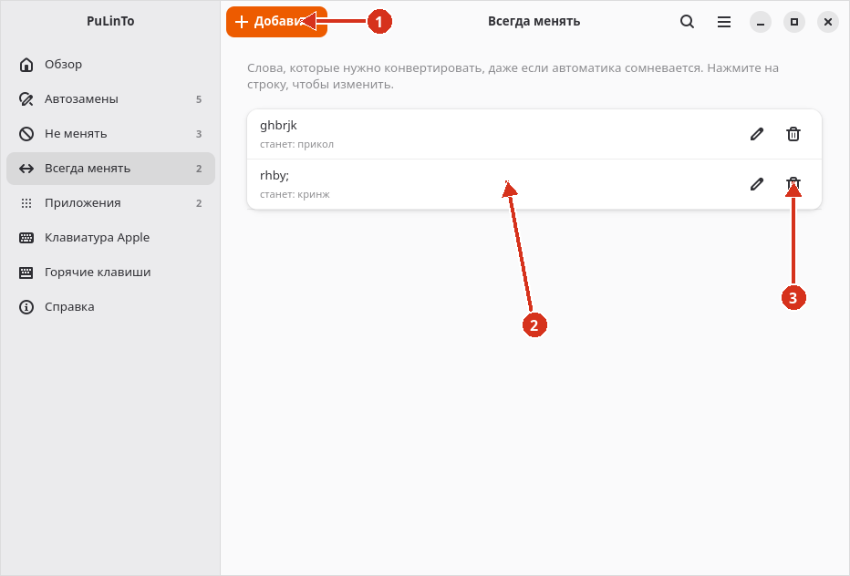

### Приложения

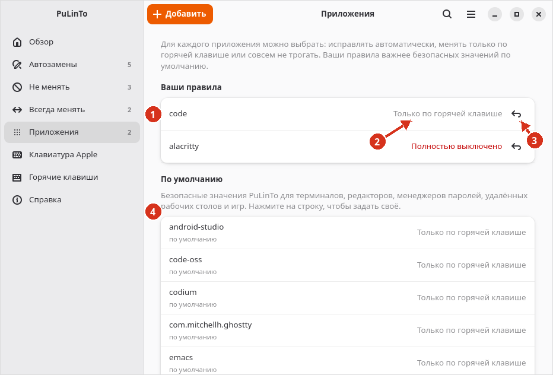

Для каждой программы можно выбрать, что делает PuLinTo:

- **Автоматически:** исправляет сам.
- **Только по горячей клавише:** сам не исправляет, но клавиша исправления работает, в том числе
  после пробела.
- **Полностью выключено:** программа не вмешивается совсем и не перехватывает одиночный `Alt`.

1. **Ваши правила.** Программы, для которых вы выбрали режим. Строка записывается по классу окна
   (`WM_CLASS`).
2. **Режим** программы. Щелчок по строке меняет его.
3. **Стрелка** возвращает значение по умолчанию.
4. **По умолчанию.** Безопасные значения PuLinTo для терминалов, редакторов кода, менеджеров
   паролей, удалённых рабочих столов и игр: там программа исправляет только по клавише. Нажатие
   на строку создаёт собственное правило.

Быстрее: `Ctrl+Alt+P` меняет режим окна в фокусе по кругу (автоматически, только по горячей клавише,
выключено), а в меню значка то же делается одним щелчком.

### Клавиатура Apple

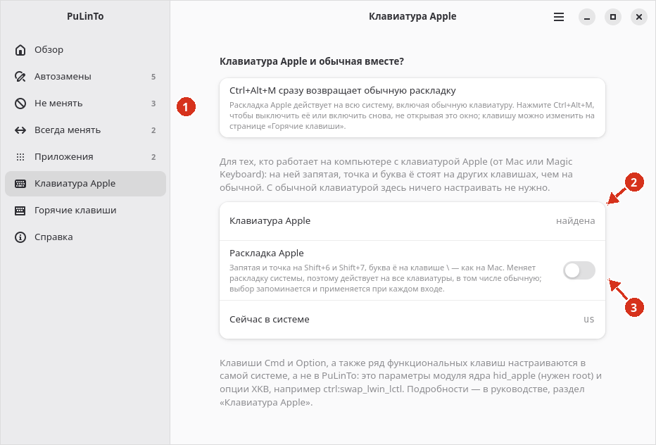

Страница нужна только тем, у кого есть клавиатура Apple (от Mac или Magic Keyboard). На ней
запятая, точка и буква ё стоят не на тех клавишах, что на обычной, и PuLinTo умеет переставить
их, как привыкли пользователи Mac. С обычной клавиатурой здесь ничего настраивать не нужно.

1. **Две клавиатуры вместе.** Раскладка в системе одна на все клавиатуры, поэтому раскладка Apple
   действует и на обычную: её знаки тоже переедут. Клавиша **`Ctrl+Pause/Break`** (на клавиатуре Apple **`Ctrl+Alt+'`**) включает и
   выключает раскладку Apple сразу, из любого окна, и показывает уведомление.
2. **Клавиатура Apple:** найдена или нет. Определяется по коду производителя, имя устройства
   значения не имеет.
3. **Раскладка Apple.** Переключатель. Выбор запоминается и применяется при каждом входе.

Что при этом меняется (это обычные варианты XKB `us(mac)` и `ru(mac)`):

| клавиша | обычная русская | Apple |
|---|---|---|
| Shift+6 | `:` | `,` |
| Shift+7 | `?` | `.` |
| Shift+5 | `%` | `:` |
| Shift+4 | `;` | `%` |
| Shift+8 | `*` | `;` |
| клавиша `\` | `\` и `/` | `ё` и `Ё` |
| клавиша `/` | `.` и `,` | `/` и `?` |
| клавиша слева от `1` | `ё` | `<` и `>` |

Правила вида `ещ\ → ещё` при раскладке Apple не нужны: буква ё стоит на клавише `\`.
Переключатель не трогает ваш прежний выбор: если для русской раскладки в системе выбран другой
вариант, например `phonetic`, раскладка Apple поверх него не ставится, а окно объясняет почему.
На Wayland работает только в GNOME. Клавиши Cmd и Option, поведение функционального ряда и обмен
Cmd с Ctrl настраиваются в самой системе (параметры ядра `hid_apple`, опции XKB вроде
`ctrl:swap_lwin_lctl`), PuLinTo их не меняет.

### Горячие клавиши

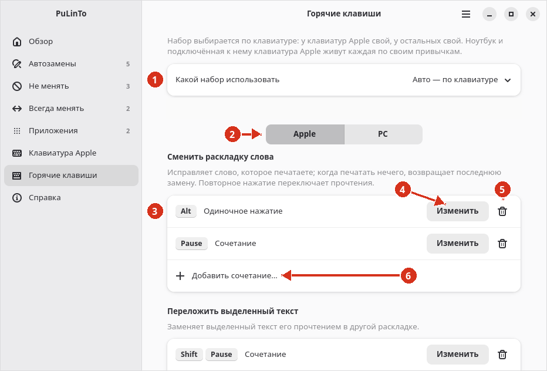

Клавиши собраны в два набора, Apple и PC, и каждую можно изменить. Набор выбирается по
клавиатуре, а не по системе: клавиатура Apple живёт по набору Apple, остальные — по набору PC.
Ноутбук и подключённая к нему клавиатура Apple работают каждая по своим привычкам. Строка под
выбором набора перечисляет подключённые клавиатуры и их наборы (на снимке она скрыта).

1. **Какой набор использовать.** «Авто — по клавиатуре», «Всегда Apple» или «Всегда PC».
2. **Вкладки наборов.**
3. **Привязки действия:** клавиша и её вид, «Сочетание» или «Одиночное нажатие».
4. **Изменить.** Открывает диалог «Нажмите сочетание клавиш».
5. **Убрать привязку.** Действие без привязок выключено.
6. **Добавить сочетание…** Одно действие может иметь несколько привязок.

Действия и клавиши по умолчанию:

| Действие | Apple | PC |
|---|---|---|
| Сменить раскладку слова | одиночный `Alt`, `Pause/Break` | `Pause/Break`, одиночный правый `Ctrl` |
| Переложить выделенный текст | `Shift+Pause/Break` | `Shift+Pause/Break` |
| Режим в приложении по кругу | `Ctrl+Alt+P` | `Ctrl+Alt+P` |
| Сообщить об ошибке исправления | `Ctrl+Alt+\` | `Ctrl+Alt+\` |
| Включить или выключить раскладку Apple | `Ctrl+Alt+'` | `Ctrl+Pause/Break` |

В наборе PC одиночный `Alt` отдан приложениям: по нему открывается меню в GTK, Qt, LibreOffice и
Firefox, и программа не хочет это ломать. Его можно вернуть кнопкой «Добавить сочетание…»,
нажав и отпустив `Alt`. На ноутбуках без `Pause/Break` работает одиночный правый `Ctrl`.

**Диалог «Нажмите сочетание».** Запись делает демон, а не окно, поэтому видны `Super` и одиночные
модификаторы. В диалоге виден обратный отсчёт десяти секунд; `Esc` или закрытие диалога отменяют
запись. Пока идёт запись, замены не срабатывают. Нельзя назначить голую печатную клавишу без
`Ctrl`, `Alt` или `Super` (без модификатора можно только `Pause`, `Scroll Lock`, `Print Screen`,
`Menu` и `F1`–`F24`), клавишу, которая уже есть у другого действия того же набора, и аварийное
сочетание. Если сочетание уже занято в GNOME, окно предупредит, но сохранит привязку.

**Аварийное снятие захвата — `Backspace`, `Esc` и `Enter` одновременно.** Демон отпускает
клавиатуру и до перезапуска её не трогает. Сочетание нельзя изменить.

### Диагностика

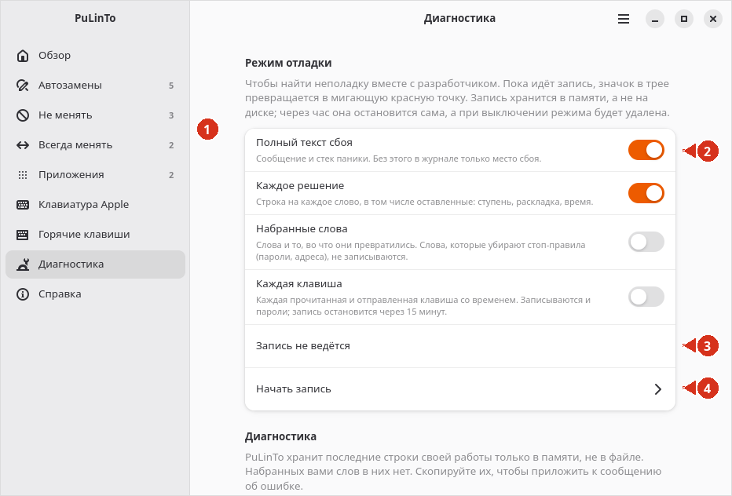

1. **Режим отладки.** Нужен, чтобы найти неполадку вместе с разработчиком. При каждом запуске выключен:
   состояние не запоминается.
2. **Что записывать.** Полный текст сбоя, строку на каждое решение; по желанию набранные слова и каждую клавишу
   (в этом случае в записи будут ваши тексты и пароли, перед запуском окно предупредит).
3. **Состояние.** Пока идёт запись, на значке в трее горит красная точка, а здесь написано, сколько минут осталось.
   Запись лежит в памяти, а не на диске, и останавливается сама: через час, запись клавиш через 15 минут.
4. **Начать запись.** Когда запись идёт, на этом месте две кнопки: «Остановить и удалить» и «Остановить и сохранить
   копию» (копия ложится в домашний каталог, её нужно просмотреть перед отправкой). Остановить запись можно и из
   меню значка в трее.

Ниже, в блоке «Последние строки журнала», кнопка «Копировать» копирует в буфер то, что демон помнит о своей работе (слов,
которые вы набирали, там нет): это можно приложить к сообщению об ошибке.

### Справка

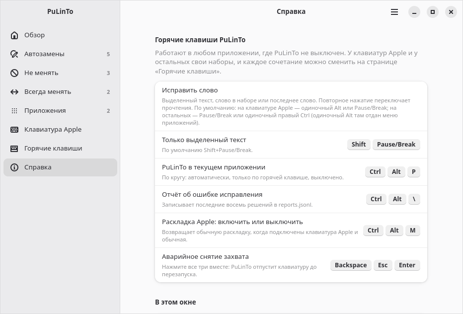

На странице «Справка» собраны клавиши PuLinTo по умолчанию (ваши изменения видны на странице
«Горячие клавиши»), аварийное сочетание, клавиши самого окна и то, что программа хранит.

---

## Язык интерфейса

Окно настроек и меню значка говорят на русском и английском. По умолчанию язык берётся из
языка системы, иначе показывается английский. Выбрать язык
вручную можно в любой момент: в меню значка («Язык интерфейса») или в меню окна настроек.
Выбор запоминается и действует и в трее, и в окне; окно при смене языка перезапускается на той
же странице. Если нужен другой язык интерфейса, перевод — это файл примерно из 280 строк:
[как перевести](LANGUAGES.md).

---

## Приватность

Журнала набора нет. Демон не сохраняет ни набранный, ни исправленный текст; в его вывод попадают
только тип операции, длина слова в символах и ступень решения. Журнала-файла у демона нет совсем:
последние строки его работы лежат только в памяти (окно настроек, страница «Диагностика»,
кнопка «Копировать»), а в журнал системы идут лишь строки о состоянии самого демона, не о словах.

Режим отладки (страница «Диагностика») нужен, чтобы найти неполадку вместе с разработчиком. При
каждом запуске он выключен: состояние не запоминается. Режим пишет в память (`$XDG_RUNTIME_DIR`), а не на
диск; останавливается сам через час (запись всех клавиш — через 15 минут); пока идёт запись, на значке в
трее горит красная точка; при выключении запись удаляется. По желанию в запись можно включить набранные
слова (кроме слов, которые убрали стоп-правила, например паролей) и каждую клавишу; в этом случае в записи
будут ваши тексты и пароли, поэтому копию для отправки нужно просмотреть.

Что попадает на диск:

- `~/.config/pulinto/config.conf` — настройки;
- `~/.local/share/pulinto/` — ваши правила: `replacements.tsv`, `never.txt`, `always.txt` и
  списки режимов приложений. Файлы создаются с правами `0600`;
- `~/.local/share/pulinto/reports.jsonl` — диагностический отчёт. Пишется **только** по явному
  нажатию `Ctrl+Alt+\`, потому что содержит последние восемь решений вместе с прочтениями слов.
  Права `0600`;
- `~/.local/share/pulinto/forgotten.sha256` — список «забытых» слов. Само слово не сохраняется:
  записывается необратимый отпечаток с отдельным локальным ключом установки.

Выделенный текст (X11 PRIMARY; под Wayland он доступен через Xwayland, только на чтение) демон
читает ровно в двух случаях: по клавише исправления с выделением и при записи отчёта. Окно
настроек работает через D-Bus демона и само не читает ни буфер обмена, ни PRIMARY. Расширение
GNOME Shell сообщает демону только идентификатор окна в фокусе.

---

## Если что-то не так

Первое, что стоит попробовать: «Перезапустить» в меню значка в трее.

**Программа не исправляет слова.** Проверьте по порядку:

1. На значке в трее оранжевый пробел? Серый значок или пункт «Включить» в его меню значит, что исправления
   выключены.
2. На странице «Обзор» окна настроек помощник работает и «Исправлять автоматически» включено?
3. Выберите в меню значка «Перезапустить».
4. В настройках системы включено сочетание переключения раскладки (например, Alt+Shift)? Без
   него программа не может переключить раскладку.
5. В окне, где вы печатаете, программа не выключена? Для терминалов и редакторов кода исправление
   по умолчанию идёт только по горячей клавише.
6. Есть ли доступ к клавиатуре? Правило `udev` ставится установкой; без него демон скажет, что не
   смог открыть клавиатуры.

**Нет значка в трее.** Программа при этом работает. В «чистом» GNOME значки показывает
расширение «AppIndicator and KStatusNotifierItem Support»; установка ставит и включает его сама.
Если значка всё равно нет, выйдите из сеанса и войдите снова: GNOME подхватывает новое
расширение только при входе.

**Клавиатура не отвечает или клавиша залипла.** `Backspace`, `Esc`, `Enter` одновременно; потом
в меню значка «Перезапустить», а если не помогло, «Приостановить» и «Выйти». Если это
повторяется, сообщите об ошибке: что вы делали и какая нагрузка была на компьютере.

**После перезагрузки клавиатура снова захвачена.** Так задумано: режим хранится в настройках, и
демон поднимается в записанном.

**Правила приложений не действуют в окнах Wayland.** Расширение GNOME Shell должно быть включено,
и после установки нужно один раз выйти из сеанса и войти снова.

**Bluetooth-клавиатура переподключилась, и программа её не видит.** Выберите в меню окна
«Перепроверить клавиатуры» или «Перезапустить» в меню значка.

**Два индикатора раскладки показывают разное.** На X11 с IBus их и правда два: плагин `xkb`
панели XFCE читает XKB и показывает правду, `ibus-ui-gtk3` показывает движок IBus и после замены
может ошибаться. Верьте плагину панели.

**В VNC ничего не перехватывается.** Так задумано: иначе фоновый рабочий стол может захватить
клавиатуру раньше активного. Включается переменной окружения `PULINTO_ALLOW_REMOTE_INPUT=1`.

Последние строки работы демона можно скопировать в окне настроек: «Диагностика» → «Копировать».
Любители командной строки могут посмотреть состояние и журнал: `systemctl --user status pulintod`
и `journalctl --user -u pulintod -n 50`. Приложите вывод к обращению в поддержку.
Крайний вариант, если значка нет, а клавиатура ведёт себя странно: в терминале
`systemctl --user stop pulintod` полностью останавливает помощника и выгружает его из памяти.

---

## Для продвинутых

Всё, что ниже, нужно редко: файлы, режимы демона, привязки в файле настроек, командная строка и
устройство системы. Для обычной работы хватит разделов выше.

### Где что лежит

Установка командой и архивом без root раскладывает файлы по каталогам пользователя:

| Что | Куда |
|---|---|
| `pulintod` (демон), `pulinto` (консольная утилита), `pulinto-settings` (окно настроек) | `~/.local/bin` |
| данные: словари и языковые пакеты | `~/.local/share/pulinto` |
| расширение GNOME Shell | `~/.local/share/gnome-shell/extensions/pulinto@pulinto.ru` |
| ярлык «PuLinTo» и его значок | `~/.local/share/applications`, `~/.local/share/icons/hicolor` |
| служба systemd `pulintod` в сеансе пользователя | включается и запускается сразу |

Пакет `.deb` или `.rpm` ставит программы в `/usr/bin`, данные в `/usr/share/pulinto`, правило
udev и расширение GNOME Shell, включает службу для всех пользователей и сразу запускает её у
вошедших.

Данные демон ищет в `data/` относительно текущего каталога, затем в
`$XDG_DATA_HOME/pulinto` (по умолчанию `~/.local/share/pulinto`), `/usr/share/pulinto` и
`/usr/local/share/pulinto`. Трей ищет окно настроек рядом с демоном, затем в `/usr/local/bin` и
по `$PATH`, либо по переменной `PULINTO_SETTINGS`.

Окно можно открыть сразу на нужной странице: `PULINTO_SETTINGS_PAGE` принимает `overview`,
`replacements`, `never`, `always`, `apps`, `keyboard`, `hotkeys`, `diagnostics`, `help`; `PULINTO_ORIGIN_APP`
задаёт класс окна, из которого открыты настройки. Язык окна для проверок можно задать
переменной `PULINTO_LANG=ru` или `en`.

Файлы правил: `replacements.tsv` (третья колонка — область приложений), `never.txt` и
`always.txt` (область во второй колонке, третья отмечает источник правила), списки режимов
приложений `enabled-apps.txt` (автоматически), `manual-apps.txt` (только по горячей клавише) и
`excluded-apps.txt` (выключено). Старые двухколоночные файлы читаются как глобальные.

**Экспорт и импорт.** Экспорт создаёт JSON формата `pulinto-rules`, версия 1: автозамены, явные
правила «не менять» и «всегда менять» и явные настройки приложений во всех трёх режимах. Импорт
сначала полностью проверяет файл, затем предлагает объединить его с текущими правилами или
заменить их.

### Режимы работы демона

Режим хранится в `~/.config/pulinto/config.conf`, ключ `mode`. Работает ровно один механизм за
раз: это защита от двух корректоров, правящих одно слово наперегонки.

| `mode` | Что происходит |
|---|---|
| `grab` | **Рабочий режим и режим по умолчанию.** Демон держит клавиатуру в эксклюзивном захвате и пересылает нажатия сам. Разделитель (пробел, Enter, знак) придерживается, пока каскад решает, поэтому исправленное слово попадает в приложение раньше, чем Enter. Цена — захват со всеми его рисками, поэтому есть аварийное сочетание. |
| `observe` | Наблюдение без захвата: демон читает поток клавиш и исправляет вдогонку. На быстром наборе небезопасен: замена ложится поверх продолжающегося набора. Оставлен как запасной путь. |
| `watch` | Диагностика: демон читает и решает всё, но не меняет ничего. По каждому слову печатает раскладку, под которой оно прочитано, и вердикт. |
| `off` | Ввод не перехватывается. Демон отвечает только на запросы командной строки и D-Bus. |

Сменить режим можно из трея («Приостановить» и «Включить» переключают захват и «выключено»),
через D-Bus (`SetMode`) или правкой конфига. Демон перезапускается в новый режим сам и запоминает
его, в том числе через перезагрузку машины. Без конфига он стартует в режиме захвата; старое значение `mode = ibus` (движок IBus убран) читается так же, как `grab`.

Второй экземпляр демона завершится сам: захват физической клавиатуры защищён межсессионной
блокировкой.

### X11 и Wayland

Демон сам определяет тип сессии при старте и включает свой механизм.

**X11** (проверялось на XFCE). Клавиатура берётся через evdev в эксклюзивный захват, а замена
доставляется через XTest: стирание, готовые Unicode-символы и разделитель идут одной очередью по
одному X-соединению. Раскладку демон узнаёт по имени, а не по номеру XKB-группы: так он не
путается, когда IBus при переключении движка пересобирает раскладку. Класс окна для правил по
приложениям — `WM_CLASS`.

**GNOME на Wayland** (проверялось на GNOME 50, Ubuntu 26.04). Замена печатается скан-кодами
через виртуальную клавиатуру демона, а раскладка переключается сочетанием из настроек XKB,
набранным в том же потоке клавиш. Композитор применяет такое сочетание по порядку с соседними
клавишами, поэтому паузы не нужны: на стенде 450 из 450 замен прошли без единой. Что нужно:

- **Сочетание переключения раскладки.** В GNOME Tweaks («Клавиатура», «Дополнительные параметры
  раскладки», «Переключение на другую раскладку») должно стоять сочетание вроде Alt+Shift.
  Проверка: `gsettings get org.gnome.desktop.input-sources xkb-options` должна показать
  `grp:alt_shift_toggle`. Без него демон пользуется `Super+Space`, но тогда только при двух
  раскладках и с ожиданием подтверждения.
- **Расширение GNOME Shell** `pulinto@pulinto.ru`: его включает сам демон при первом запуске, а
  подхватывает GNOME при следующем входе в сеанс. Вручную: `gnome-extensions enable
  pulinto@pulinto.ru`. Без него демон знает класс окна только для X-приложений, и правила по
  приложениям для окон Wayland не работают. Расширение сообщает только идентификатор окна в
  фокусе, текста оно не видит. Для экрана блокировки, диалогов паролей и обзора расширение
  отвечает `gnome-shell`, и этот класс по умолчанию выключен.
- **Клавиша исправления с выделением** читает выделение через Xwayland, которое GNOME держит в
  согласии с окнами Wayland.
- **Раскладка Apple** переключается через настройки GNOME (`us+mac`, `ru+mac`), а не через
  `setxkbmap`.

Раскладка Apple записывается в `config.conf` (`apple_layout`) и ставится заново при каждом запуске:
рабочий стол сам такую смену не помнит. Таблицы, по которым PuLinTo читает клавиши, берутся с той
раскладки, которая реально стоит в системе, поэтому `ghbdtn&` превращается в «привет.» на Apple и
в «привет?» на обычной.

### Привязки и файл настроек

Привязка бывает двух видов: **сочетание** (клавиша при точно таком наборе модификаторов, например
`ctrl+alt+p`; `Ctrl+Alt+P` не сработает, если придержан ещё и `Shift`) и **одиночное нажатие
модификатора** (нажать и отпустить `Alt`, `Ctrl`, `Shift` или `Super`, ничего не нажимая в промежутке).
`Alt` и `Super` придерживаются до отпускания (по одиночному `Alt` приложения открывают меню, по
`Super` GNOME открывает обзор), `Ctrl` и `Shift` нет, поэтому `Ctrl`+щелчок мышью работает как
обычно.

В `~/.config/pulinto/config.conf` пишутся только отличия от значений по умолчанию:

```
hotkey_set = auto                   # auto | apple | pc
hotkey.pc.word = pause, tap:rctrl   # список привязок через запятую
hotkey.apple.selection =            # пусто — действие выключено
hotkey.pc.report = ctrl+alt+r
language = auto                     # auto | ru | en
```

Действия: `word`, `selection`, `toggle_app`, `report`, `apple_layout`; наборы: `apple`, `pc`.
Сочетание — `ctrl`, `alt`, `shift`, `meta` (они же `control`, `super`, `win`) и клавиша: имя
(`pause`, `scrolllock`, `print`, `menu`, `space`, `tab`, `enter`, `esc`, `f1`…`f24`, стрелки и
другие), символ по US-раскладке или evdev-код (`ctrl+alt+43`). Одиночное нажатие — `tap:alt`,
`tap:lalt`, `tap:ralt`, `tap:ctrl`, `tap:rctrl`, `tap:shift`, `tap:meta` и так далее. Строка с
привязкой, нарушающей правила (голая буква), игнорируется при чтении. Режим наблюдения (без
захвата) читает те же наборы, но проглотить нажатие не может, а «только выделенное» в нём не
работает.

### Командная строка и диагностика

Разобрать одно слово, не поднимая демона:

```
pulinto judge --context "он сказал" ghbdtn
```

Команда показывает вердикт, целевое прочтение и ступень каскада, которая ответила. Флаг
`--layout ru|us` подсказывает исходную раскладку; для языков с общим алфавитом укажите его
всегда.

Что демон думает о раскладке:

```
pulinto layout            # имя раскладки рядом с номером группы XKB
pulinto layout --watch    # следить за изменениями
pulinto layout --set ru   # переключить и показать, что получилось
```

Если взгляд контроллера и «XKB's own view» напечатаны двумя разными строками, сессия
рассинхронизирована; именно такое расхождение однажды портило текст. Режим `watch`
(`mode = watch`) решает всё, печатает раскладку и вердикт по каждому слову, но текст не трогает.

Спросить демона напрямую через D-Bus:

```
busctl --user call ru.pulinto.Daemon1 /ru/pulinto/Daemon1 ru.pulinto.Daemon1 Status
busctl --user call ru.pulinto.Daemon1 /ru/pulinto/Daemon1 ru.pulinto.Daemon1 Judge sss "ghbdtn" "он сказал" ""
```

Языковые пакеты проверяются командами `pulinto pack check <папка>` и `pulinto pack list`.

### Как принимается решение

Каскад проверок идёт от надёжных к слабым, первое срабатывание побеждает: защитные правила
(пароли, адреса, команды), инициалы и сокращения, правила языка, слова из одной-двух букв по
контексту, частотный словарь, запрещённые сочетания букв. В программу входят русский словарь
(около 207 тысяч слов) и английский (около 122 тысяч). Для решения важна не длина списка, а его
чистота: мусорные слова в больших списках вредят. Если слово исправилось неверно или не
исправилось, пришлите его: словари дорабатываются по таким случаям.

### Из исходников и без установки

Понадобятся Rust не ниже 1.82, заголовочные файлы `libdbus-1-dev` (имя пакета в Debian и Ubuntu), а
для окна настроек — Python 3, PyGObject, GTK 4 и libadwaita (в Ubuntu: `python3-gi`,
`gir1.2-gtk-4.0`, `gir1.2-adw-1`). Словари русского и английского входят в репозиторий.

```
git clone https://github.com/iResultMan/pulinto
cd pulinto
./install.sh
```

Скрипт сам собирает программу (`cargo build --release`), ставит её для вашего пользователя и
спрашивает пароль администратора для правила udev. Системная установка: `sudo ./install.sh
--system`. Без установки, из корня репозитория после сборки: `./target/release/pulintod`.
Параметры установочной команды: `... | bash -s -- --no-sudo` не просит пароль (правило тогда
ставите сами), `--system` ставит для всех пользователей в `/usr/local`.

Если клавиатуры не открылись, демон скажет об этом: нужно правило udev из
`data/70-pulinto.rules` либо группа `input` (после добавления в группу нужен новый вход) и доступ
к `/dev/uinput`.

### Свой язык

Язык подключается папкой с данными, без правки программы. Как собрать и проверить пакет:
[«Как собрать языковой пакет»](LANGUAGE_PACK.md).

<!-- english -->

---

## English

Version 1.0.0, October 2026. The manual describes what the program has now, not plans. Project site: <https://iresultman.github.io/pulinto/>.

### What it is

PuLinTo fixes a word typed in the wrong layout. You typed `ghbdtn` without noticing that the keyboard was
in English, and "привет" appears on screen. It works the other way too: `рщц` becomes `how`.
The word is fixed on the space or punctuation key, before that key reaches the window, so a chat
message goes out already correct. The layout is switched as well, and you carry on typing the next word in the
right one.

What matters from the first minute:

- **When in doubt the program touches nothing.** A missed word is fixed with one key press; a ruined
  message cannot be taken back.
- **Passwords, addresses, commands, code and words mixing two alphabets are left alone.**
- **There is no typing log.** What goes to disk is listed in the "Privacy" section.
- **The program remembers your rules:** autocorrections, words it must not touch, a mode for each
  application.

It works on X11 (tested on XFCE) and on GNOME with Wayland (GNOME 50, Ubuntu 26.04), typing in Russian
and English. Accuracy on the held-out corpus of 21,300 words: 99.38%, ruined words 0.06% ([how this was
measured](MEASUREMENTS.md)).

### Installation

#### With one command

```
curl -fsSL https://iresultman.github.io/pulinto/install.sh | bash
```

The command downloads the ready build of the latest release, checks its checksum and installs the program
for your user, without root. It asks for the administrator password once, to install the rule that lets the
program read the keyboard. You can read the text of the script at the same address before running it.

#### With an installer file

| System | File | From the terminal |
|---|---|---|
| Ubuntu, Debian, Linux Mint | `pulinto-x86_64.deb` | `sudo apt install ./pulinto-x86_64.deb` |
| Fedora, RHEL, AlmaLinux, Rocky | `pulinto-x86_64.rpm` | `sudo dnf install ./pulinto-x86_64.rpm` |
| Any Linux | `pulinto-x86_64.tar.gz` | unpack and run `./install.sh` |

The files are on the [latest release](https://github.com/iResultMan/pulinto/releases/latest) page. A `.deb`
or `.rpm` can be opened with a double click in the software centre.

#### After installing

There is nothing more to do. Corrections work right away; no reboot or new login is needed. A "PuLinTo"
launcher (the settings window) appears in the application menu and an icon in the tray: an orange space bar means working, grey means off.

Only on GNOME with Wayland, the GNOME Shell extension (it tells the program which application you are typing
in) is picked up at the next login. Until then, only the per-application rules for Wayland windows do not work.
On a plain GNOME (for example Fedora and RHEL) tray icons are shown by the "AppIndicator and
KStatusNotifierItem Support" extension; the installation installs and enables it by itself.

The system settings must have a layout-switching shortcut enabled, for example Alt+Shift: that is what the
program uses to switch the layout.

**Check that it works.** In any input field switch to the English layout and type `ghbdtn` and a space. You
should get "привет", and the layout becomes Russian.

**Update:** run the same install command again or install a new `.deb` or `.rpm`. Your rules and settings
are kept.

**Uninstall:** `./uninstall.sh` (from the archive or the sources), `sudo apt remove pulinto` or
`sudo dnf remove pulinto`. The rules and settings in your home directory stay.

### How it works in practice

**Ordinary typing.** You type. When a word is finished with a space or punctuation, the program decides
whether to leave it or fix it. The decision takes the two previous words into account and, for short words, the next one: after Russian text the
Latin `T&` and `cnh&` become "Е." and "стр.", and words of one or two letters are read by their neighbours. A
key that is a punctuation character in one layout and a letter in another (`.` is ю, `,` is б) is decided by the whole word:
`ytqhjrjvgm.nths` becomes "нейрокомпьютеры", and `hello,world` is cut into two words at the comma.

**The correction key.** If the program missed a word, press one key: a lone `Alt` or `Pause/Break` on an Apple
keyboard, `Pause/Break` or a lone right `Ctrl` on others. What it does depends on the situation:

- there is a fresh selection: it replaces the selected text with its reading in the other layout;
- there is a word being typed: it changes its layout without waiting for the space;
- the word has just been finished: it turns it into the other reading, and a further press gives the next
  one. A wrong autocorrection is undone the same way: by returning to the original word you tell the
  program "leave it alone", and it remembers.

The chance to correct is lost on any new key press, mouse click or arrow key: the cursor has moved, and it
is no longer safe to erase at the old place.

**The program made a mistake.** Press the correction key to undo the replacement. If you want us to look into
it, press `Ctrl+Alt+\` right after the mistake: the daemon writes a report of the last eight decisions to
`~/.local/share/pulinto/reports.jsonl`. The report contains words, so it is written only on your key press
and is never sent anywhere by itself.

**The keyboard does not respond.** Press `Backspace`, `Esc` and `Enter` together: the keyboard grab is
released at once. Then choose "Restart" in the tray icon menu.

### The tray icon

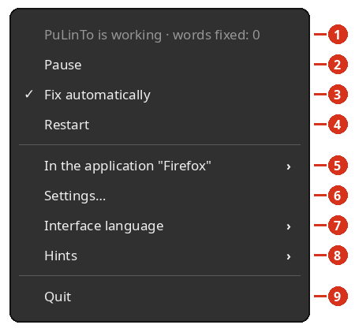

This is the menu of the icon (a diagram: your desktop draws the real menu, so its looks may differ). The
lines come in this order:

1. **State.** "PuLinTo is working · words fixed: …", "PuLinTo is off" or "PuLinTo: hotkey only".
2. **Pause / Turn on.** Turns the corrections off; the keyboard works as usual. The same item is then called
   "Turn on".
3. **Fix automatically.** Clear the tick and words are fixed only on the correction key.
4. **Restart.** The helper starts again, leaving your settings alone. The first thing to try when something
   went wrong.
5. **In the application "…".** The mode for the window you are typing in: "Fix automatically", "Hotkey
   only", "Leave alone" or "Use default" (which resets your choice).
6. **Settings…** Opens the settings window.
7. **Interface language.** "System language", "Русский", "English". The choice is remembered and
   applies to the tray and to the settings window.
8. **Hints.** The hotkeys, the emergency combination and the version.
9. **Quit.** The helper stops completely and is unloaded from memory until your next login.

If there is no tray icon the program works anyway: the settings open from the application menu. Without the
icon the helper can be stopped or restarted by logging out and back in.

### The settings window

Open the "PuLinTo" launcher in the application menu or the "Settings…" item of the icon menu. On the left is
the sidebar with the pages, on the right the page itself. The numbers beside the pages in the sidebar are the
number of rules on the page. A narrow window (under 640 pixels) collapses into one column with a "back"
button.

The window menu (the button with three bars) holds: "Refresh lists", "Re-check keyboards", "Import rules…",
"Export rules…", "Interface language" and "Help and hotkeys".

Window shortcuts: `Ctrl+F` searches the list, `Ctrl+N` adds, `Delete` removes the row in focus, `Ctrl+R` or
`F5` refreshes, `F1` is the help.

#### Overview

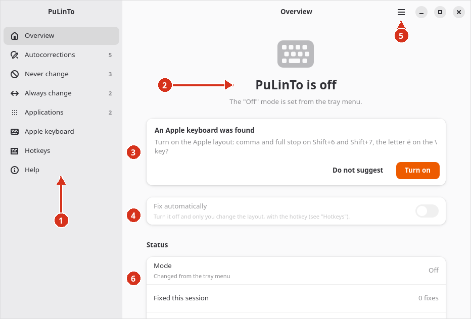

1. **The sidebar.** The pages of the window.
2. **The state.** A large caption: "The layout fixes itself", "Hotkey only" or "PuLinTo is off" (as in the
   picture).
3. **The offer for an Apple keyboard.** Appears once when an Apple keyboard is found and its layout is not on.
   You can accept or decline.
4. **Fix automatically.** The same as the tick in the icon menu. While PuLinTo is off as a whole the switch is
   unavailable.
5. **The window menu.**
6. **The state of the service:** the mode, how many words were fixed in the session and whether the helper is
   running. If the window says "No connection to PuLinTo", choose "Restart" in the icon menu.

#### Autocorrections

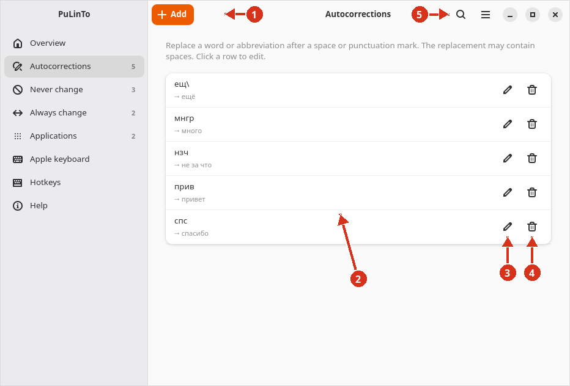

An autocorrection replaces a word or abbreviation when you finish it with a space or punctuation. The result
may contain spaces: "нзч" becomes "не за что". Sources with a punctuation character work too: `ещ\` → `ещё` swallows the
mistaken `\`.

1. **Add** (or `Ctrl+N`).
2. **A rule row.** A click on the row opens the editor.
3. **Edit.**
4. **Delete.** An autocorrection is deleted at once, and the pop-up note has "Undo".
5. **Search** the list (or `Ctrl+F`).

Autocorrections the program learned by itself after your repeated corrections are marked "learned"; where
each rule came from is shown in the tooltip of its row.

**New autocorrection.**

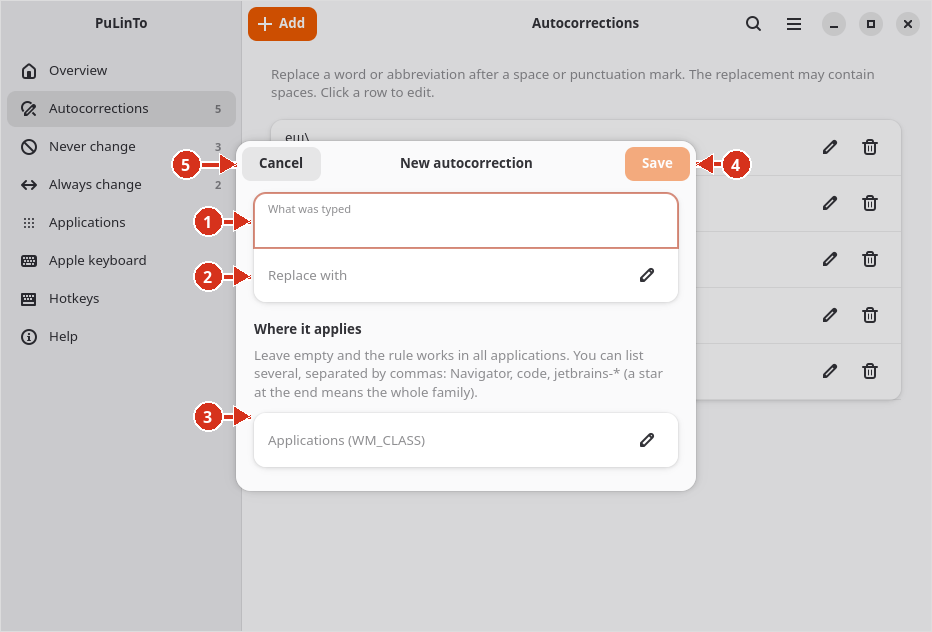

1. **What was typed.** A word or abbreviation. The "Save" button stays disabled while the required fields are
   empty; a refusal from the daemon is shown in the dialog itself and nothing you typed is lost.
2. **Replace with.** What to put instead; it may be several words.
3. **Where it applies.** Optional. Empty means "everywhere". You can list window classes separated by commas;
   a star at the end means a family: `Navigator, code, jetbrains-*`. The class of the program is shown in the
   icon menu ("In the application "…"").
4. **Save** (`Enter`).
5. **Cancel** (`Esc`).

#### Never change and Always change

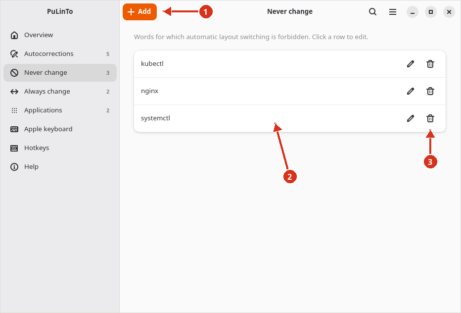

1. **Add.**
2. **The words of the list.** A click on the row opens the editor.
3. **Delete.** Asks whether to "Delete" or "Delete and forget": the second stops the program from learning the
   word again. The forgotten word itself is not stored, only an irreversible fingerprint is written (a keyed
   SHA-256 with a separate key of your installation). The "Forgotten words" row with a counter and a "Reset…"
   button is pinned to the bottom of the page while the counter is not zero. Adding the same word by hand
   allows it again.

**Never change.** Words that must not be fixed automatically: command names, nicknames, terms. A word must be
at least three characters long: frequent short words in the list would spoil the choice of language.

**Always change.** Words that must always be fixed, even when the program is unsure. Write the word as it is
typed in the wrong layout (in the picture below `rhby;` is "кринж" typed in the English layout). Under the word it shows what it becomes. The protective rules for addresses, passwords and code are stronger than this list.

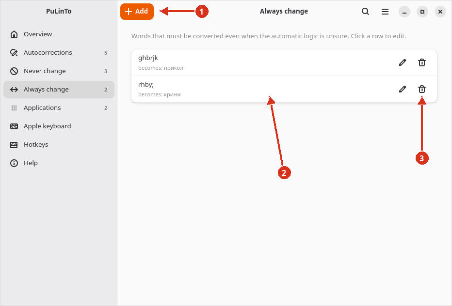

#### Applications

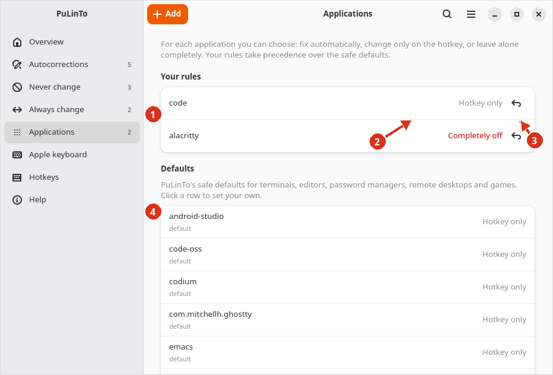

For each program you can choose what PuLinTo does:

- **Automatic:** it fixes by itself.
- **Hotkey only:** it does not fix by itself, but the correction key works, after a space too.
- **Completely off:** the program does not interfere at all and does not intercept a lone `Alt`.

1. **Your rules.** The programs for which you chose a mode. A row is recorded by the window class
   (`WM_CLASS`).
2. **The mode** of the program. A click on the row changes it.
3. **The arrow** returns the default.
4. **Defaults.** PuLinTo's safe values for terminals, code editors, password managers, remote desktops and
   games: there the program fixes only on the hotkey. A click on a row creates your own rule.

Faster: `Ctrl+Alt+P` cycles the mode of the focused window (automatic, hotkey only, off), and in the icon
menu the same takes one click.

#### Apple keyboard

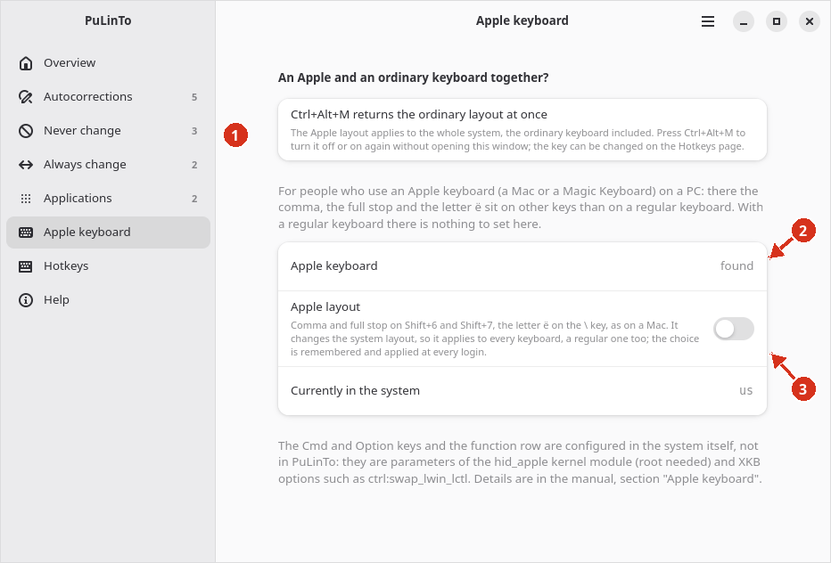

The page is only for people who have an Apple keyboard (from a Mac or a Magic Keyboard). Its comma, full
stop and letter ё are on different keys than on an ordinary keyboard, and PuLinTo can move them the way Mac
users are used to. With an ordinary keyboard there is nothing to set here.

1. **Both keyboards together.** The system has a single layout for all keyboards, so the Apple layout applies
   to the ordinary one too: its characters move as well. The key **`Ctrl+Pause/Break`** (**`Ctrl+Alt+'`** on the Apple keyboard) turns the Apple layout on and off
   at once, from any window, and shows a notification.
2. **Apple keyboard:** found or not. It is recognised by the vendor code; the device name does not matter.
3. **Apple layout.** The switch. The choice is remembered and applied at every login.

What changes (these are the ordinary XKB variants `us(mac)` and `ru(mac)`):

| key | plain Russian | Apple |
|---|---|---|
| Shift+6 | `:` | `,` |
| Shift+7 | `?` | `.` |
| Shift+5 | `%` | `:` |
| Shift+4 | `;` | `%` |
| Shift+8 | `*` | `;` |
| the `\` key | `\` and `/` | `ё` and `Ё` |
| the `/` key | `.` and `,` | `/` and `?` |
| the key left of `1` | `ё` | `<` and `>` |

Rules like `ещ\ → ещё` are not needed with the Apple layout: ё sits on the `\` key. The switch does not
override a choice you made earlier: if another variant, such as `phonetic`, is selected for Russian in the
system, the Apple layout is not put over it, and the window explains why. On Wayland it works on GNOME only.
The Cmd and Option keys, the behaviour of the function row and the swap of Cmd and Ctrl are set in the system
itself (the `hid_apple` kernel parameters, XKB options such as `ctrl:swap_lwin_lctl`); PuLinTo does not change
them.

#### Hotkeys

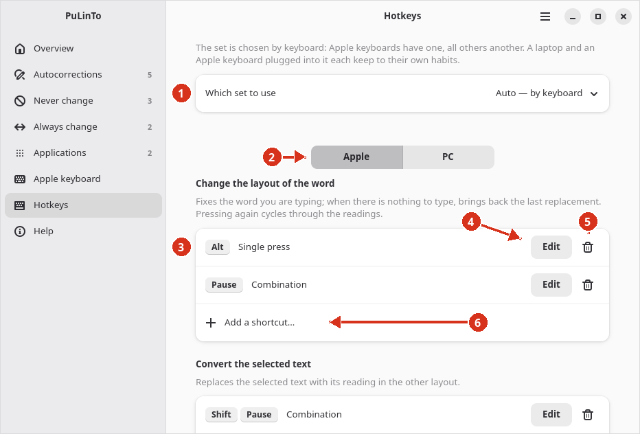

The keys come in two sets, Apple and PC, and each can be changed. The set is chosen by keyboard, not by
system: an Apple keyboard uses the Apple set, the others the PC set. A laptop and an Apple keyboard plugged
into it each keep to their own habits. The line under the set choice lists the connected keyboards and their
sets (hidden in the picture).

1. **Which set to use.** "Auto — by keyboard", "Always the Apple set" or "Always the PC set".
2. **The tabs of the sets.**
3. **The bindings of an action:** the key and its kind, "Combination" or "Single press".
4. **Edit.** Opens the "Press a key combination" dialog.
5. **Remove a binding.** An action with no bindings is off.
6. **Add a shortcut…** One action may have several bindings.

The actions and their default keys:

| Action | Apple | PC |
|---|---|---|
| Change the layout of the word | single `Alt`, `Pause/Break` | `Pause/Break`, single right `Ctrl` |
| Convert the selected text | `Shift+Pause/Break` | `Shift+Pause/Break` |
| Cycle the mode for the application | `Ctrl+Alt+P` | `Ctrl+Alt+P` |
| Report a wrong correction | `Ctrl+Alt+\` | `Ctrl+Alt+\` |
| Turn the Apple layout on or off | `Ctrl+Alt+'` | `Ctrl+Pause/Break` |

In the PC set a lone `Alt` is left to applications: it opens the menu in GTK, Qt, LibreOffice and Firefox, and
the program does not want to break that. You can bring it back with "Add a shortcut…" by pressing and
releasing `Alt`. On laptops without `Pause/Break` a single right `Ctrl` works.

**The "Press a key combination" dialog.** The daemon does the recording, not the window, so `Super` and
single modifiers are visible. The dialog counts down ten seconds; `Esc` or closing the dialog cancels the
recording. While it runs no replacements happen. You cannot assign a bare printable key without `Ctrl`, `Alt`
or `Super` (without a modifier only `Pause`, `Scroll Lock`, `Print Screen`, `Menu` and `F1`–`F24` are
allowed), a key that another action of the same set already has, or the emergency combination. If the
combination is already taken in GNOME the window warns but keeps the binding.

**The emergency release of the grab is `Backspace`, `Esc` and `Enter` together.** The daemon lets go of the
keyboard and leaves it alone until restart. The combination cannot be changed.

#### Diagnostics

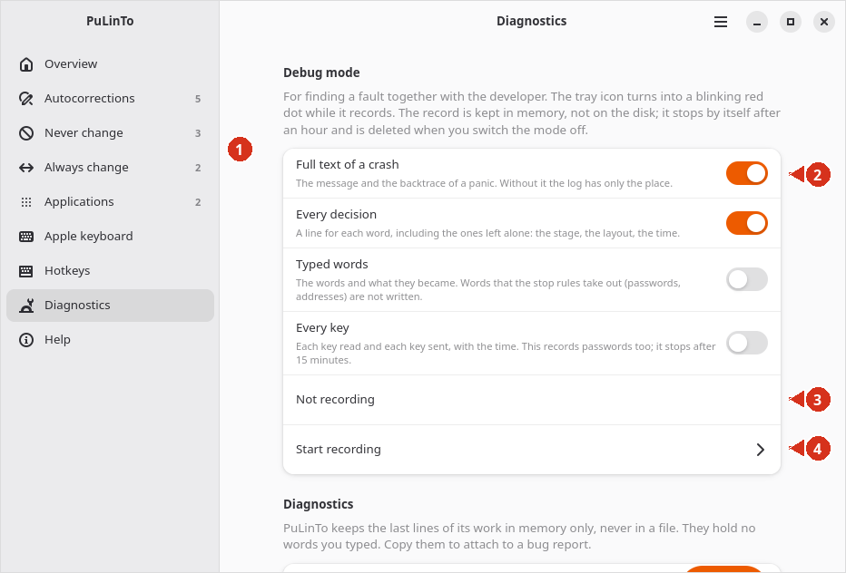

1. **Debug mode.** For finding a fault together with the developer. Off at every start: the state is not
   remembered.
2. **What to record.** The full text of a crash, a line for every decision; optionally the typed words and every
   key (then the record holds your texts and passwords, and the window warns you before it starts).
3. **State.** While it records, a red dot shows on the tray icon, and here you see how many minutes are left. The
   record is kept in memory, not on the disk, and stops by itself: after an hour, recording the keys after 15 minutes.
4. **Start recording.** While it records, two buttons stand in this place: "Stop and delete" and "Stop and save a
   copy" (the copy goes to your home directory; look through it before sending). You can also stop the recording from
   the tray icon menu.

Below the debug section, the "Last lines of the log" button copies to the clipboard what the daemon remembers of its work (the
words you typed are not in it): you can attach it to a bug report.

#### Help

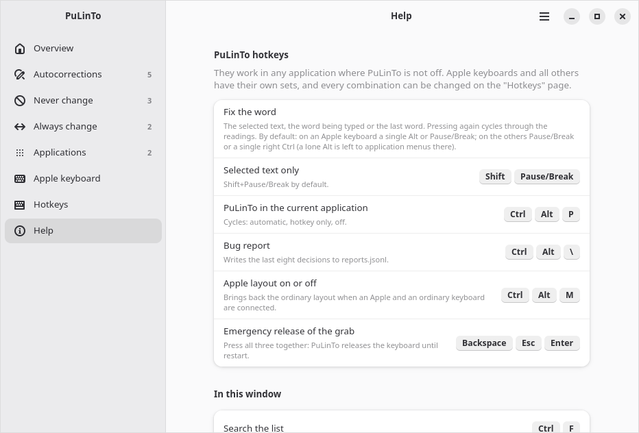

The "Help" page gathers the default keys of PuLinTo (your changes are on the "Hotkeys" page), the emergency
combination, the keys of the window itself and what the program stores.

### Interface language

The settings window and the icon menu speak Russian and English. By default the language follows the
system, otherwise English is shown. You can pick the language by hand at any time: in the icon menu
("Interface language") or in the menu of the settings window. The choice is remembered and applies to both the
tray and the window; the window restarts on the same page when the language changes. Need another interface
language? A translation is a file of about 280 strings: [how to translate](LANGUAGES.md).

### Privacy

There is no typing log. The daemon stores neither the typed nor the corrected text; its output holds only the
kind of operation, the word length in characters and the stage of the decision. The daemon has no log file at all:
the last lines of its work sit in memory only (settings window, "Diagnostics" page, the "Copy" button), and the
system journal gets only lines about the daemon's own state, not about words.

The debug mode (the "Diagnostics" page) is for finding a fault together with the developer. It is off at every start:
the state is not remembered. It writes to memory (`$XDG_RUNTIME_DIR`), not to the disk; it stops by itself after
an hour (recording every key: after 15 minutes); a red dot shows on the tray icon while it records; the record is
deleted when you switch it off. You can add the typed words (except the ones the stop rules take out, such
as passwords) and every key to the record; then it holds your texts and passwords, so look through a copy before
sending it.

What reaches the disk:

- `~/.config/pulinto/config.conf` — the settings;
- `~/.local/share/pulinto/` — your rules: `replacements.tsv`, `never.txt`, `always.txt` and the lists of
  application modes. The files are created with mode `0600`;
- `~/.local/share/pulinto/reports.jsonl` — the diagnostic report. It is written **only** on an explicit
  `Ctrl+Alt+\` press, because it holds the last eight decisions with the readings of the words. Mode `0600`;
- `~/.local/share/pulinto/forgotten.sha256` — the list of "forgotten" words. The word itself is not stored:
  an irreversible fingerprint with a separate local key of the installation is written.

The selected text (X11 PRIMARY; under Wayland it is reachable through Xwayland, read-only) is read by the
daemon in exactly two cases: on the correction key with a selection and when a report is written. The settings
window works through the daemon's D-Bus and does not read the clipboard or PRIMARY itself. The GNOME Shell
extension tells the daemon only the identifier of the focused window.

### When something is wrong

The first thing to try is always "Restart" in the tray icon menu.

**The program does not fix words.** Check in order:

1. Does the tray icon have an orange space bar? A grey icon, or a "Turn on" item in its menu, means corrections are off.
2. On the "Overview" page of the settings window, is the helper running and "Fix automatically" on?
3. Choose "Restart" in the icon menu.
4. Is a layout-switching shortcut (for example Alt+Shift) enabled in the system settings? Without it the
   program cannot switch the layout.
5. Is the program switched off in the window where you type? In terminals and code editors the correction is
   hotkey only by default.
6. Can the program read the keyboard? The installer adds the `udev` rule; without it the daemon
   says it could not open the keyboards.

**There is no tray icon.** The program works anyway. On a plain GNOME tray icons are shown by the "AppIndicator
and KStatusNotifierItem Support" extension; the installation installs and enables it by itself. If there is
still no icon, log out and back in: GNOME picks up a new extension only at login.

**The keyboard does not respond or a key is stuck.** `Backspace`, `Esc`, `Enter` together; then "Restart" in
the icon menu, and if that did not help, "Pause" and "Quit". If it keeps happening, report it: what you were
doing and how loaded the computer was.

**After a reboot the keyboard is grabbed again.** By design: the mode is kept in the settings and the daemon
comes up in the recorded one.

**Application rules do not work in Wayland windows.** The GNOME Shell extension must be on, and after the
installation you need to log out and back in once.

**A Bluetooth keyboard reconnected and the program does not see it.** Choose "Re-check keyboards" in the
window menu or "Restart" in the icon menu.

**The two layout indicators show different things.** With IBus on X11 there really are two: the `xkb` plugin of
the XFCE panel reads XKB and shows the truth, `ibus-ui-gtk3` shows the IBus engine and may be wrong after a
replacement. Trust the panel plugin.

**Nothing is intercepted in VNC.** By design: otherwise a background desktop could grab the keyboard before the
active one. Turn it on with the environment variable `PULINTO_ALLOW_REMOTE_INPUT=1`.

The last lines of the daemon's work can be copied in the settings window: "Diagnostics" → "Copy".
Command-line users can look at the state and the log: `systemctl --user status pulintod` and
`journalctl --user -u pulintod -n 50`. Attach the output to your support request. The last resort, when there
is no icon and the keyboard misbehaves: in a terminal `systemctl --user stop pulintod` stops the helper
completely and unloads it from memory.

### For advanced users

Everything below is rarely needed: files, the modes of the daemon, bindings in the settings file, the command
line and the inside of the system. The sections above are enough for everyday work.

#### Where things are

The installation by command and by archive without root puts the files in the user's directories:

| What | Where |
|---|---|
| `pulintod` (the daemon), `pulinto` (the console tool), `pulinto-settings` (the settings window) | `~/.local/bin` |
| data: dictionaries and language packs | `~/.local/share/pulinto` |
| the GNOME Shell extension | `~/.local/share/gnome-shell/extensions/pulinto@pulinto.ru` |
| the "PuLinTo" launcher and its icon | `~/.local/share/applications`, `~/.local/share/icons/hicolor` |
| the systemd service `pulintod` in the user session | enabled and started at once |

A `.deb` or `.rpm` puts the programs in `/usr/bin`, the data in `/usr/share/pulinto`, the udev rule and the
GNOME Shell extension, enables the service for all users and starts it at once for those who are logged in.

The daemon looks for data in `data/` relative to the current directory, then in `$XDG_DATA_HOME/pulinto`
(`~/.local/share/pulinto` by default), `/usr/share/pulinto` and `/usr/local/share/pulinto`. The tray looks for
the settings window next to the daemon, then in `/usr/local/bin` and in `$PATH`, or at the path in the
variable `PULINTO_SETTINGS`.

The window can be opened straight on a page: `PULINTO_SETTINGS_PAGE` takes `overview`, `replacements`, `never`,
`always`, `apps`, `keyboard`, `hotkeys`, `diagnostics`, `help`; `PULINTO_ORIGIN_APP` gives the class of the window the
settings were opened from. For testing, the language of the window can be set with the variable
`PULINTO_LANG=ru` or `en`.

The rule files: `replacements.tsv` (the third column is the application scope), `never.txt` and `always.txt`
(the scope is in the second column, the third marks the source of the rule), the application mode lists
`enabled-apps.txt` (automatic), `manual-apps.txt` (hotkey only) and `excluded-apps.txt` (off). Old two-column
files are read as global.

**Export and import.** Export creates JSON of the format `pulinto-rules`, version 1: autocorrections, explicit
"never change" and "always change" rules and explicit application settings in all three modes. Import first
checks the whole file, then offers to merge it with the current rules or to replace them.

#### Modes of the daemon

The mode is kept in `~/.config/pulinto/config.conf`, the key `mode`. Exactly one mechanism works at a time:
that guards against two correctors fixing the same word in a race.

| `mode` | What happens |
|---|---|
| `grab` | **The working mode and the default.** The daemon holds the keyboard in an exclusive grab and forwards the keys itself. The separator (space, Enter, a punctuation mark) is held back while the cascade decides, so the fixed word reaches the application before Enter. The price is the grab with all its risks, so there is an emergency combination. |
| `observe` | Observation without a grab: the daemon reads the stream of keys and fixes after the fact. Unsafe at a fast typing speed: the replacement lands on top of continuing typing. Kept as a fallback. |
| `watch` | Diagnostics: the daemon reads and decides everything but changes nothing. For every word it prints the layout it was read under and the verdict. |
| `off` | Input is not intercepted. The daemon answers only command-line and D-Bus requests. |

The mode can be changed from the tray ("Pause" and "Turn on" switch the grab and "off"), through D-Bus
(`SetMode`) or by editing the config. The daemon restarts itself into the new mode and remembers it, through a
reboot as well. Without a config it starts in grab mode; the old `mode = ibus` (the IBus engine is gone) is read as `grab`.

A second instance of the daemon exits by itself: grabbing the physical keyboard is protected by an
inter-session lock.

#### X11 and Wayland

The daemon recognises the type of session at start and turns on its own mechanism.

**X11** (tested on XFCE). The keyboard is taken through evdev in an exclusive grab, and the replacement is
delivered through XTest: erasing, ready Unicode characters and the separator go in one queue over one X
connection. The daemon learns the layout by its name, not by the number of the XKB group: so it is not confused
when IBus rebuilds the layout while switching its engine. The window class for per-application rules is
`WM_CLASS`.

**GNOME on Wayland** (tested on GNOME 50, Ubuntu 26.04). The replacement is typed with scan codes through the
daemon's virtual keyboard, and the layout is switched with the shortcut from the XKB settings typed in the same
stream of keys. The compositor applies such a shortcut in order with the neighbouring keys, so no pauses are
needed: on the stand 450 of 450 replacements went through without one. What is needed:

- **A layout-switching shortcut.** In GNOME Tweaks ("Keyboard", "Additional layout options", "Switching to
  another layout") a shortcut like Alt+Shift must be set. Check: `gsettings get
  org.gnome.desktop.input-sources xkb-options` should show `grp:alt_shift_toggle`. Without it the daemon uses
  `Super+Space`, but then only with two layouts and with a wait for confirmation.
- **The GNOME Shell extension** `pulinto@pulinto.ru`: the daemon enables it itself at the first start and
  GNOME picks it up at the next login. By hand: `gnome-extensions enable pulinto@pulinto.ru`. Without it the
  daemon knows the window class only for X applications, and per-application rules do not work for Wayland
  windows. The extension reports only the identifier of the focused window; it does not see any text. For the
  lock screen, password dialogs and the overview the extension answers `gnome-shell`, and that class is off by
  default.
- **The correction key with a selection** reads the selection through Xwayland, which GNOME keeps in step with
  Wayland windows.
- **The Apple layout** is switched through GNOME's settings (`us+mac`, `ru+mac`), not through `setxkbmap`.

The Apple layout is recorded in `config.conf` (`apple_layout`) and set again at every start: the desktop does
not remember such a change itself. The key tables PuLinTo uses are taken from the layout actually set in
the system, so `ghbdtn&` becomes "привет." on Apple and "привет?" on the plain layout.

#### Bindings and the settings file

A binding is of two kinds: a **combination** (a key with exactly this set of modifiers, for example
`ctrl+alt+p`; `Ctrl+Alt+P` does not fire if `Shift` is held too) and a **single press of a modifier** (press and
release `Alt`, `Ctrl`, `Shift` or `Super` without pressing anything in between). `Alt` and `Super` are held back
until release (applications open their menu on a lone `Alt`, GNOME opens the overview on `Super`), `Ctrl` and
`Shift` are not, so `Ctrl`+mouse click works as usual.

`~/.config/pulinto/config.conf` holds only the differences from the defaults:

```
hotkey_set = auto                   # auto | apple | pc
hotkey.pc.word = pause, tap:rctrl   # a comma-separated list of bindings
hotkey.apple.selection =            # empty: the action is off
hotkey.pc.report = ctrl+alt+r
language = auto                     # auto | ru | en
```

The actions are `word`, `selection`, `toggle_app`, `report`, `apple_layout`; the sets are `apple`, `pc`. A
combination is `ctrl`, `alt`, `shift`, `meta` (also `control`, `super`, `win`) and a key: a name (`pause`,
`scrolllock`, `print`, `menu`, `space`, `tab`, `enter`, `esc`, `f1`…`f24`, arrows and others), a character of
the US layout or an evdev code (`ctrl+alt+43`). A single press is `tap:alt`, `tap:lalt`, `tap:ralt`,
`tap:ctrl`, `tap:rctrl`, `tap:shift`, `tap:meta` and so on. A line with a binding that breaks the rules (a bare
letter) is ignored when read. Observe mode (without a grab) reads the same sets but cannot swallow a key
press, and "selection only" does not work in it.

#### Command line and diagnostics

Look at one word without starting the daemon:

```
pulinto judge --context "он сказал" ghbdtn
```

The command shows the verdict, the target reading and the stage of the cascade that answered. The flag
`--layout ru|us` hints at the original layout; for languages that share an alphabet always give it.

What the daemon thinks about the layout:

```
pulinto layout            # the layout name beside the XKB group number
pulinto layout --watch    # follow the changes
pulinto layout --set ru   # switch and show what came out
```

If the controller's view and "XKB's own view" are printed as two different lines the session is out of step;
that kind of mismatch once spoiled text. The `watch` mode (`mode = watch`) decides everything, prints the layout
and the verdict for each word but does not touch the text.

Ask the daemon directly through D-Bus:

```
busctl --user call ru.pulinto.Daemon1 /ru/pulinto/Daemon1 ru.pulinto.Daemon1 Status
busctl --user call ru.pulinto.Daemon1 /ru/pulinto/Daemon1 ru.pulinto.Daemon1 Judge sss "ghbdtn" "он сказал" ""
```

Language packs are checked with `pulinto pack check <directory>` and `pulinto pack list`.

#### How a decision is made

The cascade of checks goes from reliable to weak and the first one that fires wins: the protective rules
(passwords, addresses, commands), initials and abbreviations, the rules of the language, words of one or two
letters by context, the frequency dictionary, forbidden letter combinations. The program includes a Russian
dictionary (about 207 thousand words) and an English one (about 122 thousand). What matters for the decision
is not the length of the list but its cleanliness: junk words in large lists do harm. If a word was fixed
wrongly or not fixed, send it in: the dictionaries are improved from such cases.

#### From source and without installing

You need Rust 1.82 or newer, the header package `libdbus-1-dev` (the Debian and Ubuntu name) and, for the
settings window, Python 3, PyGObject, GTK 4 and libadwaita (in Ubuntu: `python3-gi`, `gir1.2-gtk-4.0`,
`gir1.2-adw-1`). The Russian and English dictionaries are part of the repository.

```
git clone https://github.com/iResultMan/pulinto
cd pulinto
./install.sh
```

The script builds the program itself (`cargo build --release`), installs it for your user and asks for the
administrator password for the udev rule. System-wide: `sudo ./install.sh --system`. Without installing, from
the repository root after building: `./target/release/pulintod`. Parameters of the install command:
`... | bash -s -- --no-sudo` does not ask for the password (then you install the rule yourself), `--system`
installs for all users into `/usr/local`.

If the keyboards could not be opened the daemon says so: you need the udev rule from `data/70-pulinto.rules` or
the `input` group (log in again after joining the group) and access to `/dev/uinput`.

#### Your own language

A language is added with a folder of data, without changing the program. How to build and check a pack:
["Building a language pack"](LANGUAGE_PACK.md).
