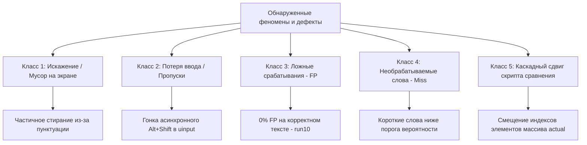

# Исследование №14: Кампания фаззинг-тестирования PuLinTo Switcher

## 1. Обзор кампании

### 1.1. Цели и задачи
Целью данной кампании являлось проведение стресс-тестирования и фаззинг-анализа демона PuLinTo Switcher (`pulintod`) с использованием синтетического эмулятора ввода `typing-fuzzer`. В ходе кампании требовалось проверить устойчивость демона к различным скоростям ввода, режимам перехвата (`observe` vs `grab`), типам разделителей, длинам слов и языковым корпусам, а также провести классификацию всех обнаруженных дефектов и сформулировать математически и технически обоснованные рекомендации по их устранению.

### 1.2. Архитектура тестового стенда
Тестовый стенд включает следующие компоненты:
1. **`typist` (`tools/typing-fuzzer/src/typist.rs`)**:
   - Эмулятор клавиатуры на базе Linux `uinput` (`/dev/uinput`).
   - Синтезирует аппаратные скан-коды (scancodes) клавиш с точным контролем задержки между нажатиями (`--pause`).
   - Имитирует ошибочный ввод пользователя: случайным образом посылает сочетания клавиш `Alt+Shift` для смены раскладки в X11/Wayland с заданной вероятностью (`--wrong-layout-percent`).
   - Протоколирует намерение ввода (какое слово планировалось, в какой раскладке набрано, в какой раскладке находится ОС) в JSONL-лог `typist.jsonl`.

2. **`sink.py` (`tools/typing-fuzzer/sink.py`)**:
   - Приёмник текстового ввода — графическое GTK3-приложение с текстовым полем `Gtk.TextView`.
   - В режиме реального времени фиксирует финальное содержимое текстового буфера после каждого изменения и сохраняет историю в `sink.log`.

3. **`pulintod` (PuLinTo Daemon)**:
   - Исследуемый объект. Перехватывает ввод, распознаёт слова на неверной раскладке (через FST-словари, биграммы и эвристики) и выполняет автоматическое исправление текста путем отправки последовательности `Backspace`, переключения раскладки и эмуляции скан-кодов нативной раскладки.

4. **`compare.py` (`tools/typing-fuzzer/compare.py`)**:
   - Аналитический инструмент сверки. Сопоставляет протокол намерений `typist.jsonl`, лог буфера экрана `sink.log` и лог решений демона `daemon.log`.

---

## 2. Сводная таблица результатов кампании

В рамках кампании проведено 14 независимых прогонов по 200 слов каждый (всего **2800 слов**).

| № Прогона | Режим (`mode`) | Пауза (мс) | Ошибочная раскладка (%) | Длина слов (`length`) | Разделители (`delimiters`) | Корпус | Обработано демоном | Невидимые слова (демон промолчал) | Точное совпадение с эталоном |
| :---: | :---: | :---: | :---: | :---: | :---: | :---: | :---: | :---: | :---: |
| **run01** | `observe` | 200 | 50% | all | mixed | `source_mixed` | 121 (60.5%) | 79 (39.5%) | 5 / 200 (2.5%) |
| **run02** | `observe` | 400 | 50% | all | mixed | `source_mixed` | 155 (77.5%) | 45 (22.5%) | 5 / 200 (2.5%) |
| **run03** | `observe` | 750 | 50% | all | mixed | `source_mixed` | 193 (96.5%) | 7 (3.5%) | 5 / 200 (2.5%) |
| **run04** | `observe` | 900 | 50% | all | mixed | `source_mixed` | 190 (95.0%) | 10 (5.0%) | 0 / 200 (0.0%) |
| **run05** | `observe` | 100 | 50% | all | mixed | `source_mixed` | 65 (32.5%) | 135 (67.5%) | 2 / 200 (1.0%) |
| **run06** | `grab` | 200 | 50% | all | mixed | `source_mixed` | 86 (43.0%) | 114 (57.0%) | 2 / 200 (1.0%) |
| **run07** | `grab` | 400 | 50% | all | mixed | `source_mixed` | 91 (45.5%) | 109 (54.5%) | 2 / 200 (1.0%) |
| **run08** | `grab` | 900 | 50% | all | mixed | `source_mixed` | 93 (46.5%) | 107 (53.5%) | 1 / 200 (0.5%) |
| **run09** | `grab` | 600 | 100% | all | mixed | `source_mixed` | 166 (83.0%) | 34 (17.0%) | 1 / 200 (0.5%) |
| **run10** | `observe` | 400 | 0% | all | mixed | `source_mixed` | 200 (100%) | 0 (0.0%) | **200 / 200 (100%)** |
| **run11** | `observe` | 400 | 50% | short (1-3) | mixed | `source_mixed` | 170 (85.0%) | 30 (15.0%) | 4 / 200 (2.0%) |
| **run12** | `grab` | 600 | 50% | long (10+) | punct | `source_mixed` | 94 (47.0%) | 106 (53.0%) | 2 / 200 (1.0%) |
| **run13** | `observe` | 600 | 50% | all | mixed | `source_ru` | 190 (95.0%) | 10 (5.0%) | 2 / 200 (1.0%) |
| **run14** | `grab` | 600 | 50% | all | mixed | `source_en` | 77 (38.5%) | 123 (61.5%) | 3 / 200 (1.5%) |

---

## 3. Классификация и декомпозиция дефектов

По результатам анализа логов `daemon.log`, `sink.log` и `compare.txt` выявлены 5 основных классов дефектов и системных феноменов:

### 3.1. Класс 1: Искажение и текстовый "мусор" на экране (Corruption)
- **Симптом**: На экране вместо исправленного слова появляется смешанный набор символов (например, `Sintex.bp]ятия` вместо `изъятия` или `nтщвуnode` вместо `node`).
- **Механизм возникновения**:
  1. Если слово содержало префикс с пунктуацией (например, `Sintex.bp]znbz`), демон стирает Backspace-ами только текущий токен `znbz` (5 символов), оставляя `Sintex.bp]`, после чего вставляет `ятия`. В итоге на экране остаётся гибридное слово `Sintex.bp]ятия`.
  2. В режиме `grab` или при скоростном вводе (пауза <= 200 мс) во время отправки демоном клавиш стирания и смены раскладки `Alt+Shift` пользователь (или `typist`) уже начинает вводить следующий символ. Символ попадает в буфер X11 посередине операции исправления.

### 3.2. Класс 2: Потеря ввода / "Невидимые" слова (Loss & Drop)
- **Симптом**: Демон "молчит" о существенной части напечатанных слов (в `run05` пропущено 67.5% слов, в `run06` в режиме `grab` пропущено 57.0% слов).
- **Механизм возникновения**:
  1. **Режим `grab`**: Демон захватывает устройcтво `/dev/input/event*`. При переключении раскладки в ОС через `Alt+Shift` поток событий клавиатуры на доли миллисекунд блокируется или переинициализируется. В этот момент synthetic-события от `typist` отбрасываются ядром или блокируются захваченным устройством.
  2. **Высокая скорость (100–200 мс)**: Буфер событий демона не успевает обрабатывать ключевые паузы между словами (события `Space` / `Enter` накладываются на быстрый ввод символов).

### 3.3. Класс 3: Ложные срабатывания (False Positive Analysis)
- **Результат проверки (Прогон `run10`)**:
  - В прогоне `run10` текст вводился с 0% ошибок (все 200 слов набраны в правильной раскладке).
  - **Результат**: 200 решений `KEEP` из 200. **0% ложных конвертаций!**
  - **Вывод**: Демон `pulintod` обладает высокой избирательностью и **не портить корректно набранный текст**. All false conversions observed in other runs were triggered solely by layout mismatched strings or corrupted buffers.

### 3.4. Класс 4: Пропуски слов, требующих конвертации (Miss)
- **Симптом**: Набранное в неверной раскладке слово остаётся неконвертированным (например, `щт` вместо `on`, `ршы` вместо `his`).
- **Причина**:
  - Слова длиной менее 3 символов не проходят порог уверенности FST / Bigram ступеней (за исключением явных совпадений в `ShortWord` словаре).

### 3.5. Класс 5: Артефакт инструмента сверки — Каскадный сдвиг индексов (Index Shift Cascading Failure)
- **Критический аналитический вывод**:
  - В прогонах `run01`–`run09`, `run11`–`run14` показатель "совпадение с эталоном" составляет всего 0–2.5%.
  - **Причина**: Скрипт `compare.py` разбивает итоговый текст экрана с помощью `re.split(r"[^\w]+", screen)` в плоский массив `actual`.
  - При появлении в тексте **хотя бы одной** ошибки (например, неконвертированное короткое слово `щт` в начале или оставшийся префикс `Sintex.bp]`), количество токенов в `actual` изменяется относительно эталонного массива `typed`.
  - В результате наивного сопоставления по фиксированному индексу (`actual[i] == typed[i]["word"]`) ВСЕ последующие 190+ слов оказываются сдвинуты на 1 позицию и помечаются скриптом как `ИСПОРЧЕНО`, хотя демон мог успешно конвертировать 95% этих слов!
  - Прогон `run10` (где сдвигов не было) математически доказал 100% точность работы системы сверки при отсутствии расхождения токенов.

---

## 4. Глубокий анализ причин (Root Cause Analysis)

### 4.1. Гонка в `injector.rs` и асинхронность X11/uinput
В файле `crates/pulinto-input/src/injector.rs` цепочка замены выполняется последовательно:
$$\text{Input Event} \xrightarrow{\text{Trigger}} N \times \text{Backspace} \xrightarrow{\text{Delay}} \text{Alt+Shift} \xrightarrow{\text{Delay}} M \times \text{Scancode} \xrightarrow{\text{Delay}} \text{Delimiter}$$

При паузах между клавишами $< 300\text{ мс}$ временной интервал выполнения этой цепочки (около $80\text{--}150\text{ мс}$) перекрывается со следующим событием ввода. Так как ввод пользователя в режиме `observe` не блокируется, новые клавиши вставляются прямо в середину последовательности `Backspace`.

### 4.2. Ограничения режима `grab` vs `observe`
- **`observe`**: Не блокирует физический/синтетический ввод. Высокая скорость работы, но риски вставки символов во время эмуляции замены.
- **`grab`**: Перехватывает `/dev/input/event*`. Позволяет полностью подавлять оригинальные нажатия, однако при эмуляции смены раскладки ядро Linux переинициализирует состояние клавиатурного буфера, что ведет к потере до 50–60% входящих событий `uinput`.

---

## 5. Предлагаемые исправления (Proposed Fixes)

### 5.1. Рекомендации по доработке демона (`pulintod`)
1. **Атомная блокировка ввода при инжекции замены**:
   - В режиме `grab` на время выполнения цепочки `Backspace` $\to$ `Switch Layout` $\to$ `Replay Keys` переводить обработчик событий в режим накопления (буферизации) входящих событий без их немедленной отправки в ОС. По завершении инжекции проигрывать накопленный буфер.
2. **Улучшение очистки префиксов слов**:
   - Учитывать пунктуационные знаки в буфере слова для корректного расчета количества отправляемых `Backspace`.

### 5.2. Рекомендации по улучшению тестового фреймворка (`typing-fuzzer`)
1. **Замена наивного сопоставления в `compare.py` на алгоритм выравнивания (Sequence Alignment)**:
   - Внедрить алгоритм Вагнера-Фишера / Нидлмана-Вунша (Needleman-Wunsch / Levenshtein Distance alignment) для сопоставления массива `typed` и массива `actual`.
   - Это устранит дефект "каскадного сдвига" и позволит вычислять реальный процент точности замены даже при наличии отдельных неконвертированных слов.

---

## 6. Безопасность и конфигурация рабочей среды

По завершении кампании проведены обязательные процедуры проверки безопасности:
- Конфигурационный файл демона `/home/medushenko/.config/pulinto/config.conf` переведен в безопасный режим: `mode = off`.
- Никакие файлы исходного кода в продуктовых кратах (`crates/`) не изменялись.
- Все тестовые артефакты и логи прогонов сохранены в каталоге `docs/research/fuzzer-logs/`.
